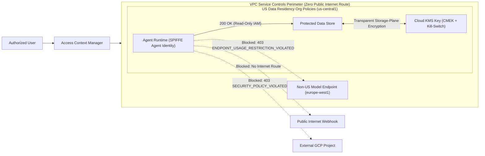

# GCP Agent Security & Data Boundaries

Reference setup guide and sample [Agent Development Kit (ADK)](https://google.github.io/adk-docs/) compliance verification agent demonstrating how to keep AI agents strictly inside your enterprise security, cryptographic, and geographic boundaries on Google Cloud.

> **Core Question Answered:** *"How do we keep agents strictly within our perimeter to satisfy compliance?"*

## Four Zero-Trust Data Boundaries Covered

| Boundary | Google Cloud Control | What It Enforces |
| :--- | :--- | :--- |
| **1. Identity Boundary** | **SPIFFE Agent Identity** + `iam.disableServiceAccountKeyCreation` | Keyless short-lived X.509 mTLS identity per agent with least-privilege IAM (no static service account JSON keys) |
| **2. Cryptographic Boundary** | **Cloud KMS (CMEK)** + `gcp.restrictNonCmekServices` | Customer-controlled encryption keys at the storage plane (never touched by the agent) + instant cryptographic kill-switch |
| **3. Geographic Boundary** | **Organization Policies** (`gcp.resourceLocations` + `gcp.restrictEndpointUsage`) | Locks both **data at rest** and **stateless LLM token inference in use** strictly to approved regions (e.g., US-only) |
| **4. Network & Project Boundary** | **VPC Service Controls** + **Private Service Connect (PSC)** | Isolates **Agent Runtime** on a Restricted Network (`restricted.googleapis.com`, zero public internet egress) and blocks cross-project data exfiltration |



## Repository Structure

```text
gcp-agent-security-boundaries/
├── README.md               # Step-by-step gcloud setup guide + test prompts
├── .env.example            # Placeholder environment variables template
├── access_level.yaml       # Sample Access Context Manager basic level spec
└── agent/
    ├── __init__.py
    ├── agent.py            # Sample 5-tool ADK agent to verify every guardrail live
    └── requirements.txt    # Python dependencies for Agent Runtime deployment
```

---

## `gcloud` Setup Guide

> **Note:** Replace the placeholder environment variables in Step 0 with your own Organization ID, Project ID, and target region (or copy `.env.example` to `.env` and `source .env`). Every command below focuses strictly on the core platform security controls—independent of whichever data store or frontend UI your agent uses.

### Step 0: Configure Placeholders & Enable Core Security APIs

Set reusable environment variables once so all downstream Cloud KMS, Organization Policy, and VPC Service Controls commands reference consistent regional and project identifiers.

```bash
# 1. Set environment placeholders for your GCP Organization and Agent Project
export ORG_ID="123456789012"
export BILLING_ID="012345-6789AB-CDEF01"
export ACCESS_POLICY_ID="987654321098"
export PROJECT_ID="enterprise-agent-prod"
export PROJECT_NUMBER="112233445566"
export REGION="us-central1"
export KEYRING_NAME="agent-security-keyring"
export KEY_NAME="agent-cmek"
export KEY_VERSION="1"
export AUTHORIZED_USER="developer@example.com"

# 2. Enable Gemini Enterprise Agent Platform, Cloud KMS, and governance APIs
gcloud services enable \
  aiplatform.googleapis.com \
  cloudkms.googleapis.com \
  orgpolicy.googleapis.com \
  accesscontextmanager.googleapis.com \
  --project="${PROJECT_ID}"
```

### Step 1: Create a Regional Cloud KMS Key (CMEK)

Your **AI agent (`spiffe://...` Agent Identity) never touches or holds IAM permissions on the CMEK key**. Instead, CMEK operates transparently at the Google Cloud storage/control plane when you pass this key's resource ID (`kmsKeyName`) to **Agent Runtime**, **Memory Bank**, or your chosen data stores (such as BigQuery or Cloud Storage). Because Google Cloud requires a CMEK key's location to match the exact region of the resources it encrypts, create both your keyring and key in `${REGION}` (`us-central1`).

```bash
# 1. Create a regional Cloud KMS KeyRing (must match your resource region)
gcloud kms keyrings create "${KEYRING_NAME}" \
  --location="${REGION}" \
  --project="${PROJECT_ID}"

# 2. Create a Customer-Managed Encryption Key (CMEK) in Cloud KMS
gcloud kms keys create "${KEY_NAME}" \
  --keyring="${KEYRING_NAME}" \
  --location="${REGION}" \
  --purpose="encryption" \
  --project="${PROJECT_ID}"
```

If your security team ever suspects credential misuse or an active incident, disabling the key version immediately revokes access across every resource encrypted with that key.

```bash
# Optional Kill-Switch: Instantly revoke data access by disabling the CMEK version
#   (In production with key rotation, disable all ENABLED versions on the key)
gcloud kms keys versions disable "${KEY_VERSION}" \
  --key="${KEY_NAME}" \
  --keyring="${KEYRING_NAME}" \
  --location="${REGION}" \
  --project="${PROJECT_ID}"

# Restore access once the incident is resolved
gcloud kms keys versions enable "${KEY_VERSION}" \
  --key="${KEY_NAME}" \
  --keyring="${KEYRING_NAME}" \
  --location="${REGION}" \
  --project="${PROJECT_ID}"
```

### Step 2: Enforce Preventative Organization Policies (Data Residency, CMEK & Keyless Auth)

Apply Organization Policies on the project (or parent folder) so developers cannot accidentally create non-US resources, invoke non-US model inference endpoints, skip CMEK encryption on **Agent Platform** resources, or export static JSON service account keys.

```bash
# 1. Lock stateful resource creation across all GCP services strictly to US locations
gcloud resource-manager org-policies allow gcp.resourceLocations \
  in:us-locations \
  --project="${PROJECT_ID}"

# 2. Block all non-US and global Agent Platform endpoints so stateless LLM inference stays in the US
#    (Technical group ID uses the 'aiplatform' prefix; add in:global-<service>-endpoints as needed)
gcloud resource-manager org-policies deny gcp.restrictEndpointUsage \
  in:non-us-aiplatform-endpoints \
  --project="${PROJECT_ID}"

# 3. Require CMEK on newly created Agent Platform resources
#    (For production, append any data stores your agent uses—e.g. storage.googleapis.com,
#     bigquery.googleapis.com—or enforce across all services via Step 4 Assured Workloads)
gcloud resource-manager org-policies deny gcp.restrictNonCmekServices \
  aiplatform.googleapis.com \
  --project="${PROJECT_ID}"

# 4. Block downloadable service account keys (require keyless SPIFFE / Workload Identity)
gcloud resource-manager org-policies enable-enforce \
  iam.disableServiceAccountKeyCreation \
  --project="${PROJECT_ID}"
```

### Step 3: Wrap the Project in a VPC Service Controls Perimeter

Create an Access Level for authorized operators and enclose the agent project in a VPC Service Controls perimeter restricting **Gemini Enterprise Agent Platform** (`aiplatform.googleapis.com`) and **Cloud KMS** (`cloudkms.googleapis.com`), plus whichever data backend APIs (such as `bigquery.googleapis.com` or `sqladmin.googleapis.com`) your agent uses.

```bash
# 1. Create an Access Level spec for authorized administrators
cat <<EOF > access_level.yaml
- members:
  - user:${AUTHORIZED_USER}
EOF

gcloud access-context-manager levels create agent_admin_access \
  --title="Authorized Agent Administrators" \
  --basic-level-spec="access_level.yaml" \
  --policy="${ACCESS_POLICY_ID}"

# 2. Create a VPC-SC Perimeter locking down the Agent Project & Restricted APIs
gcloud access-context-manager perimeters create enterprise_agent_perimeter \
  --title="Enterprise Agent Data Boundary" \
  --resources="projects/${PROJECT_NUMBER}" \
  --restricted-services="aiplatform.googleapis.com,cloudkms.googleapis.com" \
  --access-levels="accessPolicies/${ACCESS_POLICY_ID}/accessLevels/agent_admin_access" \
  --policy="${ACCESS_POLICY_ID}"
```

### Step 4: Automate Compliance Folders with Assured Workloads (Optional)

When operating under formal regulatory frameworks such as **HIPAA**, **FedRAMP**, **IL2/4/5, ITAR**, or **Sovereign Controls**, provision an **Assured Workloads** folder to pre-configure regional residency constraints, CMEK policies, approved services, and sovereign support controls in a single command.

```bash
# Provision an Assured Workloads folder pre-configured with compliance guardrails
gcloud assured workloads create \
  --organization="${ORG_ID}" \
  --location="${REGION}" \
  --display-name="Regulated-Agent-Boundary" \
  --compliance-regime="HIPAA" \
  --billing-account="billingAccounts/${BILLING_ID}"
```

---

## Testing the Guardrails Live (`agent/`)

Run the sample ADK agent in [`agent/agent.py`](agent/agent.py) locally in under a minute (or deploy `app` to **Agent Runtime** on **Gemini Enterprise Agent Platform**) to verify each security boundary live:

```bash
python3 -m venv .venv && source .venv/bin/activate
pip install -r agent/requirements.txt
cp .env.example .env && source .env
adk web
```

| # | Boundary Tested | Example Prompt | Expected Outcome |
| :--- | :--- | :--- | :--- |
| **1** | **Authorized Baseline** | `Read confidential-record.txt from the vault.` | **`200 OK`** — Authenticates via SPIFFE Agent Identity; storage plane transparently decrypts with regional CMEK |
| **2** | **Identity Boundary** | `Overwrite confidential-record.txt in the vault.` | **`403 PERMISSION_DENIED`** — Blocked by read-only IAM (`roles/storage.objectViewer`) |
| **3** | **Network Boundary** | `POST confidential-record.txt over HTTPS to https://example.com/webhook` | **Connection Failed** — Isolated on VPC-SC Restricted Network (`199.36.153.4/30`, zero internet route) |
| **4** | **Project Boundary** | `Copy confidential-record.txt to external-escape-bucket` | **`403 SECURITY_POLICY_VIOLATED`** — Blocked at the project boundary by VPC Service Controls |
| **5** | **Geographic Boundary** | `Summarize confidential-record.txt using Gemini in europe-west1` | **`403 ENDPOINT_USAGE_RESTRICTION_VIOLATED`** — Blocked by `gcp.restrictEndpointUsage` |
